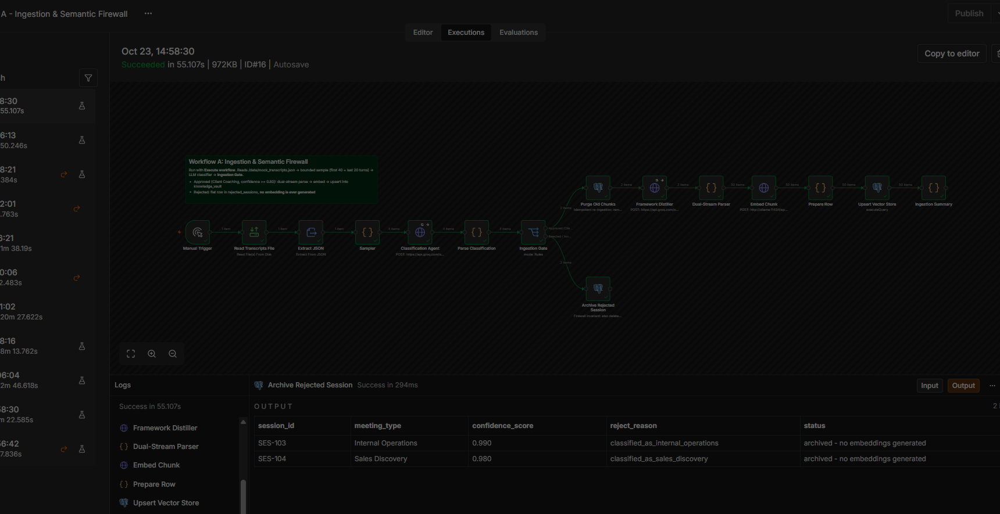
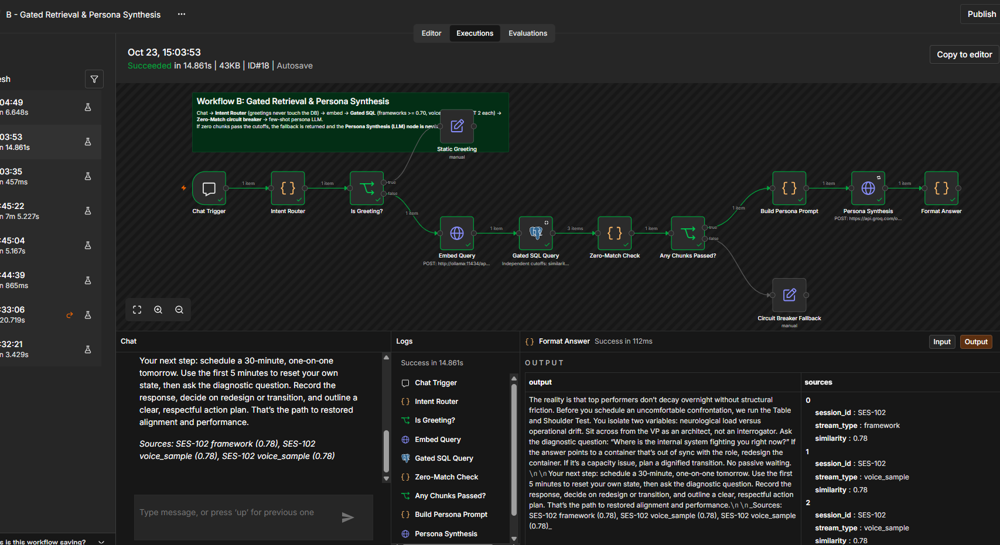
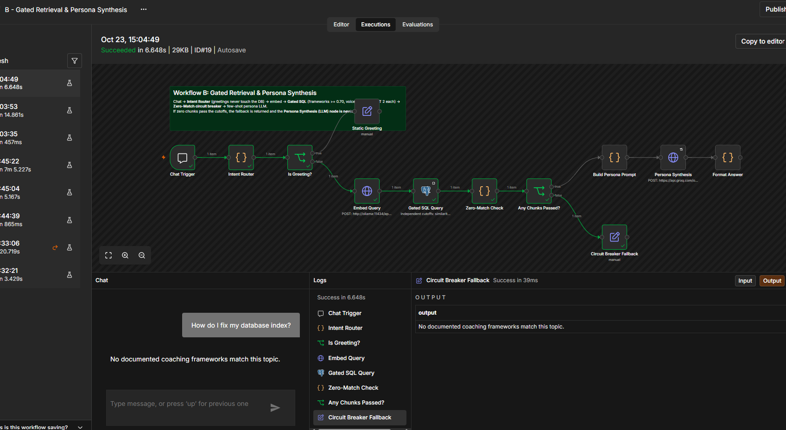

# Bounded Dual-Stream RAG & Ingestion Firewall in n8n

A local RAG pipeline in **n8n** backed by **PostgreSQL 16 + pgvector**.

- **Workflow A (Ingestion & Semantic Firewall)** classifies each meeting transcript with an LLM. Only client-coaching sessions are allowed into the vector store. Internal-ops and sales calls are archived in a flat table and never embedded.
- **Workflow B (Gated Retrieval & Persona Synthesis)** answers coaching questions in Dr. Sara's voice. Retrieval is gated by hard cosine-similarity cutoffs in SQL. When nothing passes the cutoffs, a circuit breaker returns fixed fallback, and the LLM is never called.

```
                        ┌──────────────── Workflow A: Ingestion & Semantic Firewall ────────────────┐
mock_transcripts.json → Sampler (first 40 + last 20 turns) → Classification Agent (LLM, strict JSON)
                      → Parse Classification (safe JSON parse) → Ingestion Gate (Switch)
                            ├─ Approved: Client Coaching AND confidence ≥ 0.80
                            │     → Purge Old Chunks → Framework Distiller (LLM) → Dual-Stream Parser
                            │     → Embed Chunk (bge-m3) → Prepare Row → Upsert knowledge_vault
                            └─ Rejected / Archive (everything else)
                                  → rejected_sessions (flat table, no embeddings)

                        ┌──────────────── Workflow B: Gated Retrieval & Persona Synthesis ───────────┐
Chat → Intent Router (regex) ─ greeting → Static Greeting            (no DB, no LLM)
                             └ question → Embed Query → Gated SQL (framework ≥ 0.70, voice ≥ 0.65, LIMIT 2 each)
                                         → Zero-Match Check → Any Chunks Passed?
                                              ├─ no  → "No documented coaching frameworks match this topic."   (LLM never called)
                                              └─ yes → Build Persona Prompt (few-shot) → Persona Synthesis (LLM) → Format Answer (+ sources)
```

| Component | Choice | Why |
|---|---|---|
| Orchestration | n8n (`n8nio/n8n:latest`, tested on 2.44.6) | Required |
| Vector DB | `pgvector/pgvector:pg16`, `vector(1024)`, HNSW `vector_cosine_ops` | Required |
| Embeddings | **bge-m3** via local Ollama (1024-d) | Local, free, multilingual, matches `vector(1024)` |
| LLM | **Groq** `openai/gpt-oss-20b` (free tier) | Fast (~0.4 s per call); see [Design decisions](#design-decisions--deviations) |

---

## Repository structure

```
├── docker-compose.yml          # 1-click startup: Postgres+pgvector, Ollama (+ model pull), n8n
├── init.sql                    # pgvector extension, knowledge_vault, HNSW index, rejected_sessions
├── .env.example                # copy to .env and add your GROQ_API_KEY (.env is git-ignored)
├── scripts/
│   └── bootstrap.sh            # n8n entrypoint: on first boot imports credentials + both workflows
├── workflows/
│   ├── ingestion_firewall.json # Workflow A
│   └── gated_retrieval.json    # Workflow B
├── data/
│   └── mock_transcripts.json   # the dataset (mounted read-only into n8n at /data)
├── docs/
│   └── screenshots/            # n8n execution screenshots used in the verification log
└── README.md
```

---

## 1. Quickstart

**Prerequisites**
- Docker Desktop (or Docker Engine with Compose v2), with at least **4 GB** of memory available to Docker.
- A free Groq API key from https://console.groq.com/keys. No card is needed.

```bash
# 1. Clone
git clone https://github.com/avishkar197/n8n-RAG.git
cd n8n-RAG

# 2. Add your Groq key (.env is git-ignored)
cp .env.example .env            # Windows PowerShell: Copy-Item .env.example .env
#    then edit .env and set:  GROQ_API_KEY=gsk_...

# 3. Start everything
docker compose up -d

# 4. Wait for the one-time model download (bge-m3, ~1.2 GB) to finish
docker compose logs -f ollama-pull           # Ctrl+C once it has exited
docker compose ps -a                         # ollama-pull should show "Exited (0)"
```

What `docker compose up` does:

1. `postgres` starts and runs `init.sql` once, which creates the extension, both tables and the HNSW index.
2. `ollama` starts, then `ollama-pull` downloads `bge-m3` and exits.
3. `n8n` starts only after Postgres is healthy and the model pull has succeeded. On its first boot, `scripts/bootstrap.sh` imports:
   - the **Local pgvector** Postgres credential;
   - the **Groq API** header-auth credential, built from `GROQ_API_KEY`;
   - both workflows.

   Nothing needs to be wired up by hand.

**Open n8n and run the pipeline**

5. Open **http://localhost:5678** and create the owner account. The account is local only; any email works.
6. Run ingestion:
   1. Open **A - Ingestion & Semantic Firewall** and click **Execute workflow**. It takes about a minute.
   2. Check the **Ingestion Gate** node: 2 items should go to *Approved* and 2 to *Rejected / Archive*.
   3. Check the **Ingestion Summary** node for the per-session chunk counts.
7. Run retrieval:
   1. Open **B - Gated Retrieval & Persona Synthesis** and click **Open chat** at the bottom of the canvas.
   2. Send these test messages:
      - `Hello`
      - `How should I approach an underperforming VP?`
      - `How do I fix my database index?`
8. Inspect the database (optional):
   ```bash
   docker exec rag-postgres psql -U rag -d ragdb -c "SELECT session_id, stream_type, count(DISTINCT md5(content)) AS chunks, count(*) AS vectors FROM knowledge_vault GROUP BY 1,2 ORDER BY 1,2;"
   docker exec rag-postgres psql -U rag -d ragdb -c "SELECT session_id, meeting_type, confidence_score, reject_reason FROM rejected_sessions;"
   ```

**Re-importing the workflows** after editing the JSON files (this overwrites workflows A and B in n8n):
```bash
docker exec rag-n8n rm -f /home/node/.n8n/.rag_seeded
docker compose restart n8n
```

**Reset everything** (deletes the DB, the downloaded models and n8n data):
```bash
docker compose down -v
```

---

## 2. Verification Log

These logs and screenshots come from real executions on 2026-10-23. They were taken from n8n's execution history (`execution_entity` / `execution_data`) and from `psql`.

### ✅ Call 1 & Call 2 ingested into `knowledge_vault`

Execution **#16** of *Workflow A* succeeded in 55 s. The *Parse Classification* and *Ingestion Summary* outputs:

```
Parse Classification: {"session_id":"SES-101","meeting_type":"Client Coaching","confidence_score":0.97,"reject_reason":null}
Parse Classification: {"session_id":"SES-102","meeting_type":"Client Coaching","confidence_score":0.97,"reject_reason":null}
Ingestion Summary:    {"session_id":"SES-101","status":"ingested","framework_chunks":1,"voice_sample_chunks":2,"vectors_stored":25}
Ingestion Summary:    {"session_id":"SES-102","status":"ingested","framework_chunks":1,"voice_sample_chunks":2,"vectors_stored":25}
```

The resulting rows in `knowledge_vault`:

```
 session_id | stream_type  | chunks | vectors | min_chars | max_chars
------------+--------------+--------+---------+-----------+-----------
 SES-101    | framework    |      1 |       9 |       690 |       690
 SES-101    | voice_sample |      2 |      16 |       383 |       454
 SES-102    | framework    |      1 |       9 |       599 |       599
 SES-102    | voice_sample |      2 |      16 |       379 |       408
```

A *chunk* is a distinct piece of content. A *vector* is one row per retrieval key (see [Multi-vector retrieval keys](#3-multi-vector-retrieval-keys-hypothetical-question-indexing)).

The stored framework chunk for SES-102, distilled by the LLM:

> Framework: Table and Shoulder Test. Elena, a manager, must give tough feedback to a former top performer whose deliverables have slipped, causing friction among leadership. The core principle is to diagnose whether the issue stems from neurological load or operational drift by isolating two variables. She should sit with the VP as an architect, ask the diagnostic question, 'Where is the internal system fighting you right now?' and then decide whether to redesign the container or transition the role. …

### ✅ Call 3 & Call 4 rejected by the classification agent

From the same execution (#16):

```
Parse Classification:     {"session_id":"SES-103","meeting_type":"Internal Operations","confidence_score":0.99,"reject_reason":"classified_as_internal_operations"}
Parse Classification:     {"session_id":"SES-104","meeting_type":"Sales Discovery","confidence_score":0.98,"reject_reason":"classified_as_sales_discovery"}
Archive Rejected Session: {"session_id":"SES-103","status":"archived - no embeddings generated"}
Archive Rejected Session: {"session_id":"SES-104","status":"archived - no embeddings generated"}
```

```
$ SELECT session_id, meeting_type, confidence_score, reject_reason FROM rejected_sessions;
 session_id |    meeting_type     | confidence_score |           reject_reason
------------+---------------------+------------------+-----------------------------------
 SES-103    | Internal Operations |            0.990 | classified_as_internal_operations
 SES-104    | Sales Discovery     |            0.980 | classified_as_sales_discovery

$ SELECT count(*) FROM knowledge_vault WHERE session_id IN ('SES-103','SES-104');
 0
```

**Screenshot: Workflow A, execution #16.** The Ingestion Gate sends 2 items up the Approved branch (purge → distil → parse → embed → upsert → summary) and 2 items down to *Archive Rejected Session*. The output panel shows SES-103 and SES-104 archived with no embeddings generated.



### ✅ Greeting intercepted without any DB lookup

Execution **#17** of *Workflow B* took 0.5 s.

```
nodes ran: Chat Trigger > Intent Router > Is Greeting? > Static Greeting
input:     "hello"   → intent: greeting
output:    Hello! I'm Dr. Sara's coaching assistant. Ask me about leadership topics from her sessions,
           for example delegation, giving difficult feedback, or handling an underperforming leader.
```

### ✅ Valid coaching question → retrieves SES-102 and answers in Dr. Sara's voice

Execution **#18** of *Workflow B* took 15 s.

```
nodes ran: Chat Trigger > Intent Router > Is Greeting? > Embed Query > Gated SQL Query > Zero-Match Check
           > Any Chunks Passed? > Build Persona Prompt > Persona Synthesis > Format Answer
question:  "How should I approach an underperforming VP?"
retrieved: SES-102 framework    similarity 0.780   (cutoff 0.70)
           SES-102 voice_sample similarity 0.780   (cutoff 0.65)
           SES-102 voice_sample similarity 0.780   (cutoff 0.65)
```

The answer returned to the chat:

> The reality is that top performers don't decay overnight without structural friction. Before you schedule an uncomfortable confrontation, we run the Table and Shoulder Test. You isolate two variables: neurological load versus operational drift. Sit across from the VP as an architect, not an interrogator. Ask the diagnostic question: "Where is the internal system fighting you right now?" If the answer points to a container that's out of sync with the role, redesign the container. If it's a capacity issue, plan a dignified transition. No passive waiting.
>
> Your next step: schedule a 30-minute, one-on-one tomorrow. Use the first 5 minutes to reset your own state, then ask the diagnostic question. Record the response, decide on redesign or transition, and outline a clear, respectful action plan. That's the path to restored alignment and performance.
>
> _Sources: SES-102 framework (0.78), SES-102 voice_sample (0.78), SES-102 voice_sample (0.78)_

The answer is grounded in SES-102 only. It uses the framework's steps and Dr. Sara's own phrasing from the voice samples ("The reality is…", "as an architect, not an interrogator", "No passive waiting").

**Screenshot: Workflow B, execution #18.** The question takes the full path, and every node through *Persona Synthesis* and *Format Answer* ran. The Gated SQL passed 3 items, and the chat and output panels show the answer with its SES-102 sources.



### ✅ Off-domain question → circuit breaker fallback, LLM not called

Execution **#19** of *Workflow B*:

```
nodes ran: Chat Trigger > Intent Router > Is Greeting? > Embed Query > Gated SQL Query > Zero-Match Check
           > Any Chunks Passed? > Circuit Breaker Fallback
question:  "How do I fix my database index?"
retrieved: 0 rows   (best similarity in the vault ≈ 0.55, below both cutoffs)
output:    No documented coaching frameworks match this topic.
```

*Build Persona Prompt* and *Persona Synthesis* do not appear in the list of executed nodes, so the LLM was never called.

**Screenshot: Workflow B, execution #19.** The run ends at *Circuit Breaker Fallback*. *Build Persona Prompt*, *Persona Synthesis* and *Format Answer* stayed grey (not executed), and the chat shows the fixed fallback message.



### Retrieval behaviour across more questions

These were run with Workflow B's exact gated SQL against the stored vault:

| Question | Passed the gate | Best similarity |
|---|---|---|
| How should I approach an underperforming VP? | SES-102 (1 framework + 2 voice) | 0.780 |
| How do I give tough feedback to a senior leader? | SES-102 (1 framework + 2 voice) | 0.715 |
| How do I stop micromanaging my team? | SES-101 (1 framework + 2 voice) | 0.826 |
| How do I fix my database index? | nothing → circuit breaker | – |
| What should our pricing be for a 6-month retainer? | nothing → circuit breaker | – |

---

## Design decisions & deviations

### 1. LLM on Groq, embeddings local
The assignment allows local Ollama models or free API tiers. This was developed on a laptop with 7.7 GB RAM and no GPU. Windows, Docker, n8n, bge-m3 and a local chat model together exceeded physical memory. The host started swapping heavily and generation dropped to about 0.1 tokens/s, so classifier calls hit the 10-minute timeout.

Moving only the chat LLM to Groq fixed this. Calls now take about 0.4 s and classification quality is better. Embeddings stay local, so no document text is sent for embedding. On a machine with more RAM, the three LLM nodes can point back at Ollama (`http://ollama:11434/v1/chat/completions`, which is OpenAI-compatible) with no other changes.

The Groq key lives only in `.env`. It is turned into an n8n credential at first boot and never appears in the workflow JSON.

### 2. Ingestion firewall: safe by default
- The classifier is asked for strict JSON (`response_format: json_object`, temperature 0).
- *Parse Classification* never throws. It handles each of these cases:
  - code fences around the JSON;
  - JSON buried in prose;
  - unknown labels, which are matched case-insensitively against the 4 allowed values;
  - a non-numeric confidence, which is clamped to 0–1;
  - an HTTP failure, because the node runs with `continueRegularOutput`.

  Any of these degrades to `Other @ 0.0` with a `reject_reason`, so a broken classifier fails **closed**: it archives the session and never leaks it into the vector store.
- The **Ingestion Gate** Switch passes an item only when `meeting_type == "Client Coaching" AND confidence_score >= 0.80`. Everything else takes the fallback output to `rejected_sessions`.
- **Idempotent and consistent.** Each session ends up in exactly one table:
  - Re-running ingestion first deletes a session's old chunks and any stale archive row.
  - Archiving a session also deletes any vectors it had from an earlier run.

### 3. Multi-vector retrieval keys (hypothetical-question indexing)
With bge-m3, a short question compared with a long passage scores only about 0.45–0.55, even when the passage is the right answer. With the raw chunks, *"How should I approach an underperforming VP?"* scored **0.49** against the SES-102 framework, while the off-topic *"How do I fix my database index?"* scored **0.47**. The specified cutoffs (0.70 / 0.65) were unreachable, and there was almost no margin between relevant and irrelevant questions.

Rather than lowering the cutoffs, the ingestion stores better retrieval keys:
- The **Framework Distiller** reads the labelled transcript (COACH / CLIENT) and returns:
  - the framework name;
  - a dense takeaway;
  - 8 plain-language questions that a manager with the client's problem would ask.
- `content` stays exactly what the LLM and the user see. The **embedding** is computed from a retrieval key, and each chunk is stored once per key:
  - **framework** rows: the takeaway itself plus each of its questions (9 rows per framework);
  - **voice_sample** rows: the verbatim coach text, keyed by each of the session's questions (8 rows per voice chunk).
- The gated SQL keeps the per-stream cutoffs and `LIMIT 2`. It uses `DISTINCT ON (stream_type, md5(content))`, so each chunk appears once, with its best-matching key. The matched key is stored in `metadata.retrieval_key` for auditability.

Result: relevant questions now score 0.71–0.83 and off-topic ones at most about 0.58, so the specified cutoffs work as intended.

### 4. Dual-stream parsing
- **voice_sample**:
  - only the coach's turns (speaker = the participant with `is_team_member: true`);
  - kept verbatim, with no timestamps or speaker labels;
  - split on sentence boundaries and packed greedily up to 700 characters;
  - a short last chunk borrows sentences from the previous chunk while both stay valid.
- **framework**: the LLM-distilled takeaway. If the LLM reply is unusable, a heuristic fallback picks the coach turns that mention a framework, test, criteria, etc.

### 5. Persona prompt
- The system prompt describes Dr. Sara's voice positively: open with a direct reframe, use short declarative sentences and architecture metaphors, name the framework, and close with one next step.
- Two few-shot examples on unrelated topics show the target tone. They are given as user/assistant turns, and there is no negative ban list.
- Retrieved frameworks and voice samples are injected as two labelled context blocks.
- The answer ends with a sources footer that includes the similarity scores.

### Known limitations
- **Dataset size.** The provided `mock_transcripts.json` has 5–6 turns per call, not the ~1,500 words described in the brief. The 40 + 20 turn sampler is implemented, but it does not cut anything on this data.
- **Short voice chunks.** Two voice chunks are 379–383 characters, slightly under the 400 minimum. Each coach has only about 840 characters of dialogue per call. That can't be split into two 400–700-character chunks on sentence boundaries, and splitting mid-sentence would break her speaking rhythm.
- **Recall depends on question wording.** Phrasings far from every generated question can still miss. For example, *"I review everything myself and I am burning out"* scores about 0.59 and returns the fallback. Generating more or more varied questions per framework would improve recall, at the cost of more vectors.
- **Groq model availability.** Model IDs change. If `openai/gpt-oss-20b` is retired, list the currently available models with `curl -H "Authorization: Bearer $GROQ_API_KEY" https://api.groq.com/openai/v1/models` and change `model` in the three LLM nodes.

### Environment tuning in `docker-compose.yml`
| Variable | Why |
|---|---|
| `N8N_RUNNERS_GRANT_TOKEN_TTL=300`, `N8N_RUNNERS_TASK_REQUEST_TIMEOUT=300` | On slow machines, the JS task runner that executes Code nodes can take more than 30 s to start |
| `N8N_EXPRESSION_ENGINE_TIMEOUT=60000` | Expressions run in an isolated VM with a 5 s default limit. Passing a 1024-d vector as a query parameter can exceed that on a busy machine |
| `OLLAMA_KEEP_ALIVE=60m` | Keeps bge-m3 loaded between workflow steps, avoiding slow cold loads |
| `N8N_RESTRICT_FILE_ACCESS_TO=/data` | n8n may read only the mounted dataset folder |

---

## 3. Architectural Reflection Questions

### Q1. Why does threshold gating in SQL perform better than asking the LLM in the prompt to say "I don't know"?

1. **It's deterministic and testable.** `1 - (embedding <=> q) >= 0.70` gives the same answer every time and can be unit-tested and audited per query. Similarity is logged in the sources footer. A prompt instruction is a probabilistic request, so its behaviour changes with temperature, model version and context wording.
2. **The LLM is biased toward answering.** Instruction-tuned models are trained to be helpful. If you give one loosely related context, it will usually stitch together a plausible answer instead of refusing. That is exactly the hallucination the gate exists to prevent, and the model has no calibrated sense of whether the retrieved text actually answers the question.
3. **Irrelevant context never reaches the model.** The gate works on retrieval, upstream of generation. With prompt-only refusal, off-topic chunks are still injected, and the model can quote them as if they were relevant (for example, Dr. Sara's "information architecture" line answering a database question).
4. **It costs nothing when it fires.** On a miss the workflow short-circuits. There is no LLM call, no tokens and no latency (execution #19 above), and the fallback message is exact and consistent.
5. **Each stream can be tuned separately.** Frameworks (0.70) and voice samples (0.65) have independent cutoffs, which a prompt cannot express precisely.

The trade-off is that thresholds depend on the embedding model and must be calibrated. Cosine scores from bge-m3 sit in a different range from, say, OpenAI embeddings. This project hit that directly: see [design decision 3](#3-multi-vector-retrieval-keys-hypothetical-question-indexing). A good setup uses the SQL gate as the hard guarantee and keeps a grounding instruction in the prompt as a second line of defence.

### Q2. What are the trade-offs of setting HNSW `ef_search` higher versus lower at query time?

`hnsw.ef_search` (pgvector default 40) is the size of the dynamic candidate list kept while walking the HNSW graph at query time. It does not require rebuilding the index; it's set per session or transaction with `SET hnsw.ef_search = 100;`.

| | Higher `ef_search` | Lower `ef_search` |
|---|---|---|
| Recall | Better: explores more of the graph and finds the true nearest neighbours more often | Worse: can miss the best match because the search stops at a local optimum |
| Latency / CPU | Slower; more distance computations per query | Faster and cheaper; more queries per second |
| Effect on this pipeline | Fewer false circuit-breaker trips | A missed true neighbour can mean nothing scores ≥ 0.70, so a valid question gets the "no frameworks" fallback |

Things that matter specifically here:
- **Filtered queries need headroom.** pgvector applies the `WHERE stream_type = …` and similarity conditions *after* the index returns its `ef_search` candidates. With a low value and a selective filter, the query can return fewer rows than `LIMIT 2`, or none at all, even though matches exist. Raising `ef_search`, or enabling `hnsw.iterative_scan` (pgvector ≥ 0.8), fixes this.
- **`ef_search` must be at least `LIMIT`.** Otherwise the index can't return enough candidates.
- **It's not the same as the build-time settings.** `m` and `ef_construction` (set to 16 / 64 in `init.sql`) decide graph quality when the index is built. `ef_search` only trades recall against latency when querying.
- **At this dataset's size, it barely matters.** With about 50 vectors, Postgres usually prefers an exact sequential scan, which has perfect recall. The multi-vector `DISTINCT ON` query also orders by chunk rather than by distance, which favours exact scans. `ef_search` becomes the main tuning knob once the vault holds tens of thousands of chunks and the HNSW index is actually used.

Rule of thumb: start at the default (40), measure recall@k against an exact scan on a sample of real queries, and raise `ef_search` until recall plateaus or latency exceeds the budget. Gated pipelines like this one should lean higher, because a recall miss turns into a refusal.
